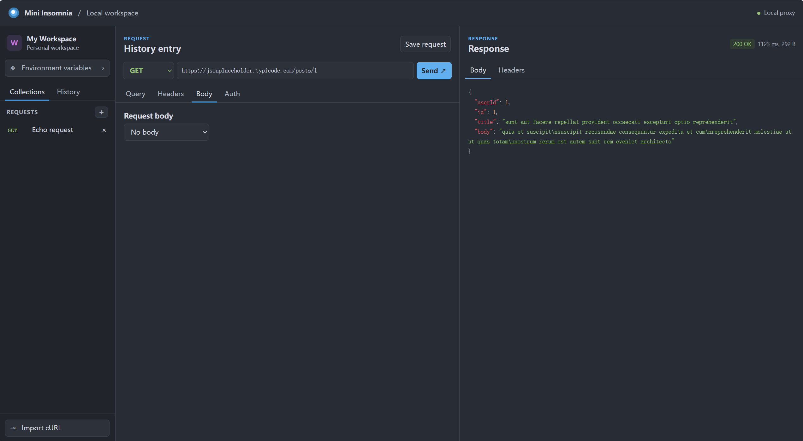
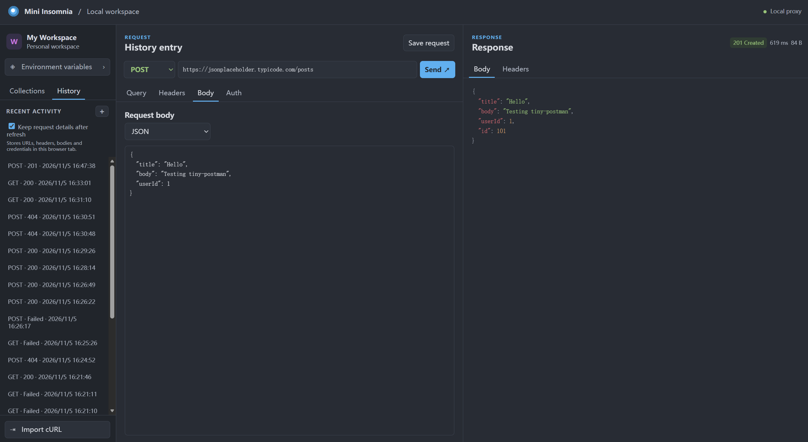

# tiny-postman

受 Insomnia 启发的轻量级本地 HTTP API 客户端。提供 Atom One Dark 三栏界面，使用原生 JavaScript 和 Node.js，无需安装第三方依赖。

## get请求和post请求示例





## 快速开始

需要 Node.js 20+。在项目目录运行：

```sh
node server.mjs
```

打开 [http://127.0.0.1:3210](http://127.0.0.1:3210)。选择 **GET**，输入 `https://jsonplaceholder.typicode.com/posts/1`，点击 **Send** 查看 JSON 响应。

## 功能

- 支持 GET、POST、PUT、PATCH、DELETE、HEAD 和 OPTIONS，可配置查询参数、请求头、JSON、纯文本和表单正文。
- 支持 Bearer、Basic Auth 和 `{{变量}}`，可导入常见的单 URL cURL 命令。
- 查看响应状态、耗时、大小、响应头和高亮 JSON。可保存请求模板和最近 50 条历史摘要。

## 本地代理与数据

代理只监听 `127.0.0.1`，由 Node.js 发送出站请求，因此目标 API 无需开启浏览器 CORS。默认仅允许公共 IPv4，校验 DNS 结果并固定连接地址，保留 TLS 校验，直接展示 3xx 响应。请求和响应各限 2 MiB，出站超时 15 秒。

| 环境变量 | 用途 |
| --- | --- |
| `PORT` | 应用端口，默认 `3210` |
| `LOCAL_TARGETS` | 显式放行的回环源，如 `http://127.0.0.1:3000` |
| `FAKE_DNS_TARGETS` | 信任本机网络代理时，为指定 HTTPS 源放行 Fake-IP 地址段，例如 `https://jsonplaceholder.typicode.com` |

两个放行列表均用逗号分隔。模板和历史摘要保存在浏览器本地。变量值仅保留在页面内存中，保存模板前请把字面凭据换成变量引用。History 可显式开启标签页会话存储，保留后续请求的详情，其中可能含有凭据。

## 测试

运行 `node --test`，通过本机回显服务验证七种 HTTP 方法、认证头转发、目标限制和重定向处理。
